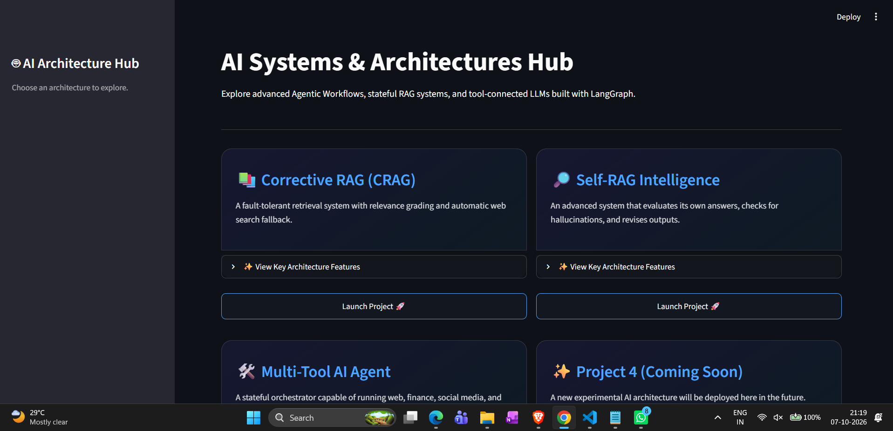
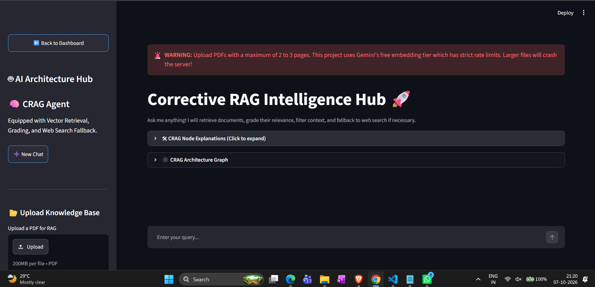
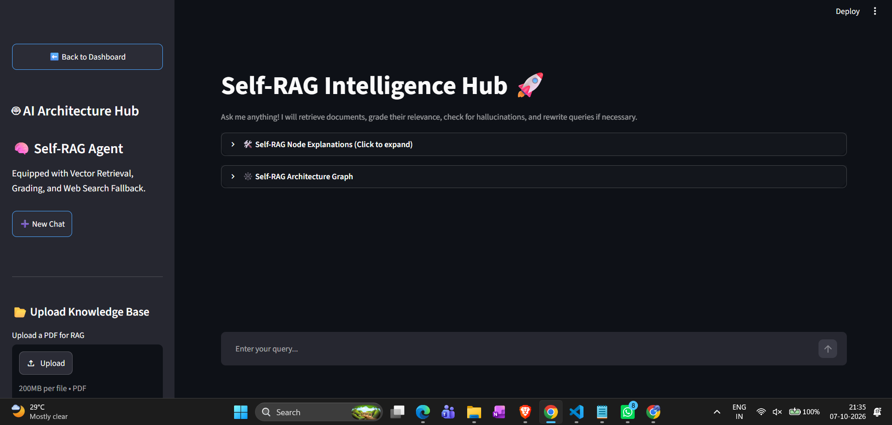
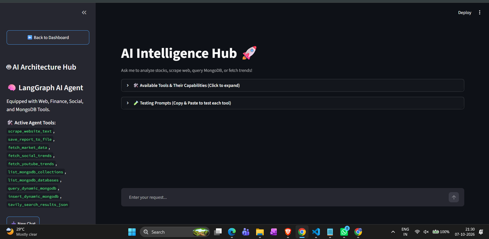

# LangGraph Multi-Agent Workflows 🤖

A unified AI hub that brings together agentic workflows, self-reflective RAG pipelines, and an autonomous tool-connected research agent in a single Streamlit dashboard.

Built with LangGraph, LangChain, Google Gemini, FAISS, MongoDB, and Streamlit. Each workflow has its own chat interface, API-key fallback for resilience, and persistent memory across sessions.

## 📸 Application Previews

### Main Dashboard Hub


### Corrective RAG (CRAG)


### Self-RAG Intelligence


### Multi-Tool AI Research Agent


## 🌟 Core Architectures & Features

### 1. 📚 Corrective RAG (CRAG)

An agentic retrieval workflow that stops irrelevant context from degrading the final answer.

- **Document Relevance Evaluator:** Grades retrieved FAISS chunks on a 0–1 scale and filters out noisy context.
- **Query Rewriter:** Rewrites vague or poorly matched queries when local retrieval falls short.
- **Tavily Web Search Fallback:** Fetches real-time web results when the uploaded documents are not enough.
- **API Key Fallback:** Uses a primary and a secondary Gemini API key for both the LLM and the embeddings, switching automatically when one fails or hits a rate limit.

### 2. 🔎 Self-RAG

A self-reflective state machine that critiques and refines its own output before answering.

- **Retrieval Router (`decide_retrieval`):** Decides whether a query needs document retrieval or can be answered directly.
- **Context Relevance Grader (`is_relevant`):** Checks whether retrieved chunks actually address the question.
- **Hallucination Grader (`is_sup`):** Verifies that each claim in the answer is supported by the source documents.
- **Usefulness Checker (`is_use`):** Checks whether the answer solves the user's intent and triggers a revision loop if it does not.

### 3. 🛠️ Multi-Tool AI Research Agent

A stateful research assistant connected to 7 tools:

- **Web Scraper (BeautifulSoup):** Extracts clean text from web pages.
- **Tavily Web Search:** Pulls real-time search results and news.
- **Market Data (yfinance):** Fetches ticker prices, market caps, and financial ratios.
- **Reddit Trends (PRAW):** Retrieves hot discussions from subreddits.
- **YouTube Trends:** Searches trending videos with the YouTube Data API v3.
- **MongoDB Tool:** Reads, writes, and queries collections in a MongoDB cluster using natural language.
- **Report Generator:** Turns research findings into Markdown reports you can download from the app.

Conversation history is stored with SQLite checkpointing (`langgraph-checkpoint-sqlite`), so the agent remembers context across turns.

## 🏗️ System Architecture

```text
                                 ┌────────────────────────┐
                                 │  Streamlit Dashboard   │
                                 │        (app.py)        │
                                 └───────────┬────────────┘
                                             │
               ┌─────────────────────────────┼─────────────────────────────┐
               ▼                             ▼                             ▼
   ┌───────────────────────┐     ┌───────────────────────┐     ┌───────────────────────┐
   │    Corrective RAG     │     │       Self-RAG        │     │    Multi-Tool Agent   │
   │  (corrective_rag/)    │     │      (self_rag/)      │     │      (tool_llm/)      │
   └───────────┬───────────┘     └───────────┬───────────┘     └───────────┬───────────┘
               │                             │                             │
    ┌──────────┴──────────┐       ┌──────────┴──────────┐       ┌──────────┴──────────┐
    │ - Document Grading  │       │ - Hallucination     │       │ - yfinance / PRAW   │
    │ - Query Rewrite     │       │   Verification      │       │ - YouTube / Tavily  │
    │ - Tavily Search     │       │ - Usefulness Check  │       │ - MongoDB Tool      │
    │ - Gemini Key        │       │ - FAISS Store       │       │ - SQLite Memory     │
    │   Fallback          │       │                     │       │                     │
    └─────────────────────┘       └─────────────────────┘       └─────────────────────┘
```

## 📁 Repository Structure

```text
Langraph_multiagent_workflows/
│
├── assets/                       # UI screenshots
│   ├── img1.png
│   ├── img2.png
│   ├── img3.png
│   └── img4.png
│
├── corrective_rag/               # Corrective RAG module
│   ├── __init__.py
│   ├── crag_backend.py
│   └── crag_frontend.py
│
├── self_rag/                     # Self-RAG module
│   ├── __init__.py
│   ├── langraph_backend.py
│   └── langraph_frontend.py
│
├── tool_llm/                     # Multi-tool research agent module
│   ├── __init__.py
│   ├── langgraph_tool_backend.py
│   └── streamlit_frontend_tool.py
│
├── app.py                        # Main Streamlit dashboard and routing
├── requirements.txt              # Python dependencies
├── .env                          # API keys (not committed)
└── README.md
```

## 🛠️ Tech Stack

| Category | Technologies |
|---|---|
| LLM | Google Gemini 3.5 Flash-Lite (via `langchain-google-genai`) |
| Orchestration | LangGraph, LangChain Core, LangChain Community |
| Frontend | Streamlit |
| Vector Store & Embeddings | FAISS, Gemini Embedding 2 |
| External APIs | Tavily Search, Yahoo Finance (yfinance), Reddit (PRAW), YouTube Data API v3 |
| Databases | MongoDB (PyMongo), SQLite (`langgraph-checkpoint-sqlite`) |
| Utilities | BeautifulSoup4, Pydantic, python-dotenv, PyPDF |

## 🚀 Local Setup

### 1. Prerequisites

Python 3.10 or higher.

### 2. Clone the repository

```bash
git clone https://github.com/muskanag16/Langraph_multiagent_workflows.git
cd Langraph_multiagent_workflows
```

### 3. Create and activate a virtual environment

**Windows:**

```bash
python -m venv venv
venv\Scripts\activate
```

**macOS / Linux:**

```bash
python3 -m venv venv
source venv/bin/activate
```

### 4. Install dependencies

```bash
pip install -r requirements.txt
```

### 5. Configure environment variables

Create a `.env` file in the project root:

```text
# Gemini API keys (primary, fallback, and tool agent)
GEMINI_API_KEY=your_primary_gemini_key
GEMINI_API_KEY_2=your_fallback_gemini_key
GEMINI_API_KEY_TOOL=your_gemini_tool_key

# Search and social media APIs
TAVILY_API_KEY=your_tavily_api_key
REDDIT_CLIENT_ID=your_reddit_client_id
REDDIT_CLIENT_SECRET=your_reddit_client_secret
YOUTUBE_API_KEY=your_youtube_api_key

# Database
MONGODB_URI=your_mongodb_connection_string
```

Only `GEMINI_API_KEY` is required to start the app. `TAVILY_API_KEY` enables web search. The Reddit, YouTube, and MongoDB keys are only needed for those tools in the research agent.

| Key | Where to get it |
|---|---|
| Gemini | [Google AI Studio](https://aistudio.google.com/apikey) |
| Tavily | [app.tavily.com](https://app.tavily.com) |
| Reddit | [reddit.com/prefs/apps](https://www.reddit.com/prefs/apps) (create a "script" app) |
| YouTube | [Google Cloud Console](https://console.cloud.google.com) (enable YouTube Data API v3) |
| MongoDB | [MongoDB Atlas](https://www.mongodb.com/cloud/atlas/register) (free M0 cluster) |

### 6. Run the app

```bash
streamlit run app.py
```

The dashboard opens at http://localhost:8501.

## ☁️ Deploying to Streamlit Community Cloud

1. Make sure `.env`, `venv/`, and `*.db` files are listed in `.gitignore`, then push the repository to GitHub.
2. Log in to [Streamlit Community Cloud](https://share.streamlit.io) and create a new app.
3. Select this repository, branch `main`, and main file `app.py`.
4. Open **Advanced settings → Secrets** and add your keys in TOML format:

```toml
GEMINI_API_KEY = "your_primary_gemini_key"
GEMINI_API_KEY_2 = "your_fallback_gemini_key"
GEMINI_API_KEY_TOOL = "your_gemini_tool_key"
TAVILY_API_KEY = "your_tavily_api_key"
REDDIT_CLIENT_ID = "your_reddit_client_id"
REDDIT_CLIENT_SECRET = "your_reddit_client_secret"
YOUTUBE_API_KEY = "your_youtube_api_key"
MONGODB_URI = "your_mongodb_connection_string"
```

5. Click **Deploy**.

## 📝 License

This project is licensed under the MIT License.
